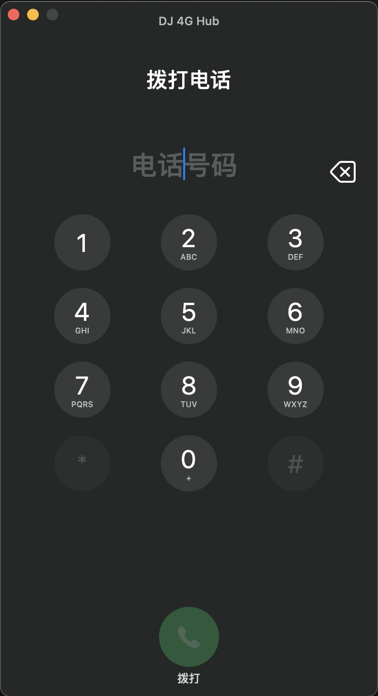
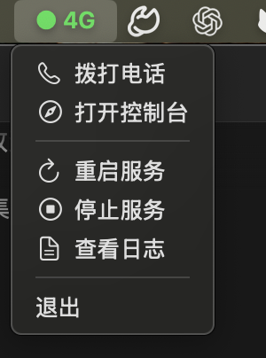

# 原生通话面板与状态栏拨号

日期：2026-11-07。

## 本次实现

- 状态栏“4G”下拉菜单新增“拨打电话”，打开独立原生数字键盘。
- 支持键盘输入、粘贴号码、鼠标点数字、删除和拨出；粘贴时去掉格式分隔符。
- 来电沿用同一窗口显示号码、接听与拒接，后到的来电号码持续更新。
- 接听后保留窗口，显示通话时长、静音、扬声器、数字键盘和挂断。
- 通话中的数字、`*`、`#` 通过模块 `AT+VTS` 发送，失败显示在面板。
- 麦克风静音与扬声器开关分别控制实际双向音频，不修改系统全局音量。
- 挂断后恢复拨号键盘；下一通重置前次的按键显示与静音状态。
- 重复打开只聚焦已有窗口。关闭窗口不挂断，来电监听继续运行。
- 外部 SIP 客户端接管电话后，本机面板不继续展示该通电话的本地控制。





## 统一方式与边界

界面与服务适合统一成一个产品入口，内部保留两个进程。
本次已把状态栏客户端源码从临时目录纳入仓库，菜单与通话窗口共享服务中的通话状态。
窗口通过专用进程管道接收状态、发出操作，拨号、接听、挂断仍由原有通话服务执行。

这样关闭窗口不会停止模块监听，窗口异常退出也不会直接结束电话。
目前仍使用已有的 LaunchAgent 服务和状态栏应用，尚未改造成一键安装、更新的完整发行包。
安装与升级、服务管理、程序签名及统一权限归属可以随后独立整合。
本次没有把音频与 USB 服务迁到界面的主线程。

静音时仍维持设备采样时钟，只将对应方向的音频置零。扬声器按钮控制当前本机通话播放，
不是在听筒、耳机与内置扬声器之间切换设备。
按键删除只清除显示，已经发送到远端的按键不能撤回。

## 安全与生命周期

每个接听、挂断、音频与按键操作均携带具体通话编号。后台拒绝已结束、过期或缺少编号的操作，
防止旧窗口控制下一通电话。按键仅接受单个数字、`*` 或 `#`，并要求电话已经接通。
界面与服务通过带序号的回复确认操作，拨号、接听和音频开关在等待期间避免重复提交。

只打开拨号键盘不会启动麦克风或模块音频流。麦克风仍遵循系统授权与既有按通话准备机制。

## 验证结果

- 完整 Go 测试通过，SIP 与主程序的竞态检查通过。
- macOS 服务与状态栏客户端构建通过。
- 原生窗口专项测试覆盖：空号码不可拨打、粘贴规范化、拨号防重复、来电接听、
  接听后面板保留、计时、展开键盘、按键、双向静音、挂断、下一通状态重置、
  号码延迟到达和外部 SIP 接管。
- 原生输出的每条操作 JSON 均交由服务的实际类型解析；专项测试发现并修复了
  Objective-C 逻辑表达式被序列化为数字、导致服务无法读取静音状态的问题。
- 模块实机返回 `+VTS: (0-9,A-D,*,#),(0-255)`，确认支持按键命令；界面仅开放数字、`*`、`#`。
- 已实际点击“4G → 拨打电话”，窗口正常打开，重复打开保持同一窗口进程。
- 从原生面板连续外呼两次，均进入本机音频运行状态。
  第二通实测麦克风静音、恢复，以及扬声器关闭、恢复，服务状态均确认生效。
  随后展开键盘并点击 `#`，界面未报告错误。远端是否识别仍需听音确认。
- 第二通结束后的麦克风转发计数为 33,792、远端转发计数为 34,272，
  模块输入非零计数为 34,775；挂断后恢复 `idle`，麦克风授权保持 `authorized`。
- 新版来电接听的真实通话尚待来电复测；原生窗口的来电状态转换已通过专项测试。

本机服务与状态栏客户端均已替换，保留了旧服务可执行文件及完整旧客户端应用备份。

## 构建与代码入口

```sh
./scripts/build-macos.sh
sh scripts/build-macos-client.sh
DJ4HUB_TEST_NATIVE_PANEL=1 go test ./cmd/dj4ghub-macos -run TestNativeCallPanelTransitions -v -count=1
```

原生专项测试会短暂打开测试窗口，不拨号、不启动音频采集。

| 代码 | 用途 |
| --- | --- |
| `cmd/dj4hub-client/main.swift` | 状态栏菜单与服务入口 |
| `cmd/dj4ghub-macos/call_panel.go` | 单窗口管理、状态管道与操作分发 |
| `cmd/dj4ghub-macos/call_window_darwin.m` | AppKit 原生拨号、来电与通话界面 |
| `cmd/dj4ghub-macos/call_alerts.go` | 来电提示音，接听后停止响铃 |
| `internal/sip/call_controls.go` | 通话按键与本机音频控制 |
| `internal/sip/local_call_audio.go` | 双向媒体传输及分别静音 |
